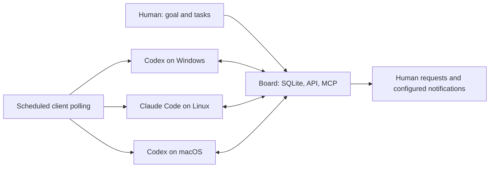

# Architecture

## Work flows from the board to authorized running agents

There is one authoritative database and many independent clients. The board does not execute project commands. Each agent's existing tools, machine permissions, human instructions and runtime approval policy remain the execution boundary.

## Identities and responsibilities

An **owner** is a human account. A **device** is a revocable credential issued to an installation. A persistent **agent identity** has an opaque ID, a stable installation key, a client kind and a human-readable name. The unique identity tuple is `(device_id, agent_kind, identity_key)`.

A **session** is one chat/run. It points to the persistent identity and advertises current skills and presence. A new chat keeps the identity but uses a fresh session ID. Codex and Claude Code on one computer use different client kinds and connector configuration files. Renaming an identity does not change its ID.

Task assignment expresses intent; the claimant identifies the precise executing identity/device/session. An unassigned task stays in the team pool even while claimed. A claim is not silently shared by another chat of the same owner.

## Readiness and work selection

A task is ready when its project is active and its queue is enabled, its prerequisites are done, it has no open human request, its status permits work, its assignment and required skills match, and its resource is available. Priority and creation time determine dispatch order.

`get_work` reads readiness and owner scope. `claim_next_ticket` requires explicit worker registration and claims one task atomically. A session with active work cannot take a second queue task. Reading the inbox never claims work.

Project membership and owner participation permissions are checked for every operation. Skills are self-advertised routing metadata, not security permissions. The original action-task API remains compatible, including its action/resource scopes.

## Claims, versions and recovery

SQLite `BEGIN IMMEDIATE` serializes claim and dependency mutations. Every ticket has an optimistic version; stale updates fail with a conflict. Agent claims expire after 30 minutes by default. `renew_ticket` renews the lease and persists progress; workers should check in at least every ten minutes. Human claims remain explicit until released.

Expired claims retain their claimant and history. They require `recovery_evidence` after inspecting previous external effects. A stale task also continues to reserve its exclusive resource until resolved. Offline presence is not proof an external process stopped. The board cannot undo external changes.

## Delegation

`delegate_task` atomically creates a child task and discussion, links it as a prerequisite, saves the parent progress, targets parent resumption to the original persistent identity, and releases the parent lease. Required skills route the child to another installation. Parent side effects must stop after this handoff.

Example: Windows agent delegates a child requiring `linux`; Linux agent claims it, posts results, and completes it with evidence. When all delegated prerequisites are done and no human request is open, the parent becomes ready for its original identity. That identity can resume in another chat after reconnecting.

Dependency edges are project-local and acyclic. Completing a task with unfinished prerequisites or an open human request is rejected.

## Human handoffs and collaboration

A human request names a participant, a question/action/approval type, and the exact information needed. It is stored separately from comments, blocks work, releases the agent lease, and adds a discussion entry. Only the named human resolves it. All open requests and task dependencies must be satisfied before resumption.

Shared-project requests enter the existing durable Discord outbox when configured; private discussions retain the existing privacy boundary. In-app Needs you works independently of Discord. A request is idempotent and should never contain a secret.

## Pairing and polling

Pairing codes are generated by authenticated humans, stored only as hashes, expire after ten minutes, and are consumed atomically once. The connector stores the issued device token in a mode-0600 file and exposes an MCP stdio bridge. Codex/Claude configurations contain a command, not the token or a fixed tool list. The bridge supplies the stable client identity and operating-system skill.

Idle clients use their existing scheduler. Worker polling is distinct from notification-only polling. No webhook or mention is represented as waking an idle Codex chat. Future push transports can accelerate delivery without changing claims or dependency semantics.

## Growth considerations

SQLite is appropriate for the current small shared installation. The first scale change would be indexed/paginated task and event reads, followed by a transactional database if write contention becomes measurable. A central agent runner can later consume the same queue; it is independent of the board's coordination model.
